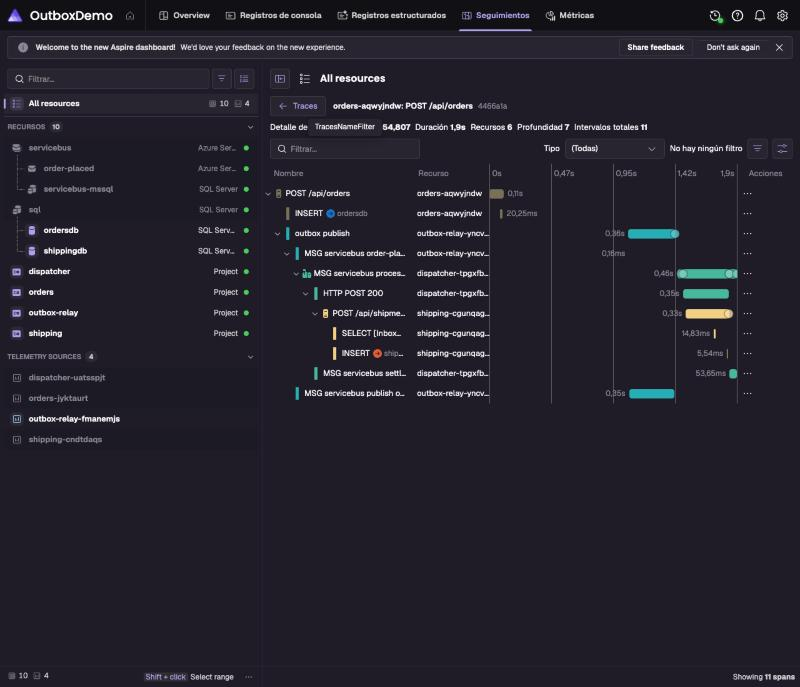
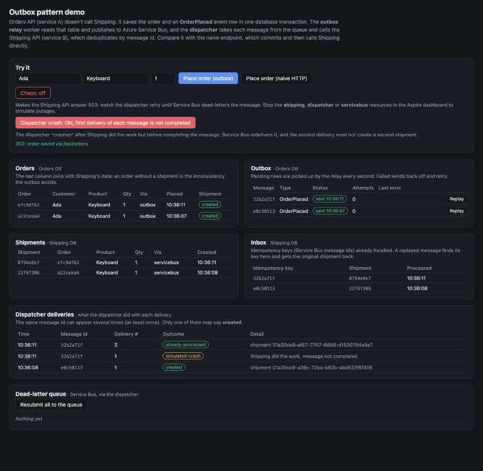
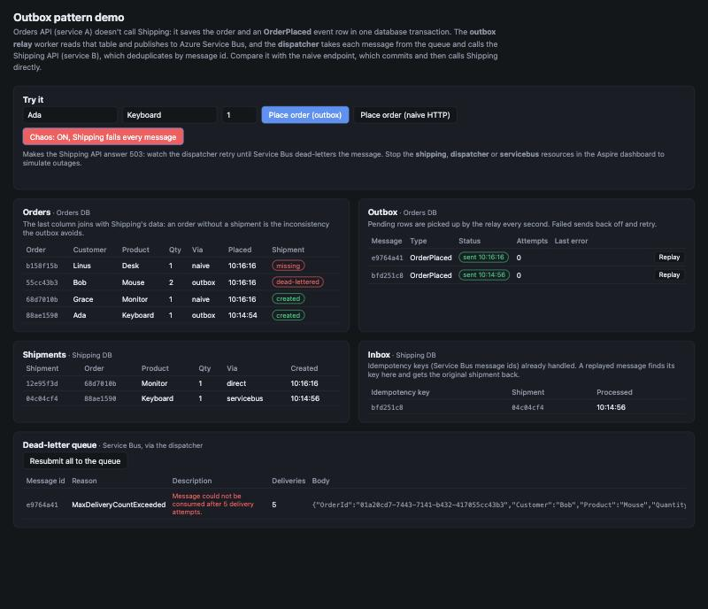

# Outbox pattern demo: .NET 10 + Azure Service Bus

Una demo del **patrón Outbox** para resolver el problema de la **doble escritura** (*dual write*).

El servicio A (**Orders**) tiene que hacer dos cosas cuando entra un pedido: guardarlo en su base de
datos **y** conseguir que el servicio B (**Shipping**, otra API) cree el envío. Las dos cosas tienen
que ocurrir juntas, como si fueran una sola transacción. Pero son dos sistemas distintos y no hay
ninguna transacción que los abarque a los dos.

La solución de esta demo: **Orders no llama a Shipping**. Guarda el pedido y un **evento** en su propia
base de datos, en la misma transacción. Un **worker** lee esa tabla de eventos y los publica en
**Azure Service Bus**, y desde la cola un **dispatcher** hace la llamada a la API de Shipping.

```
outbox-demo/
├── orders/          Servicio A: API de pedidos (guarda pedido + evento) y la UI de la demo
├── orders-data/     Modelo EF Core de la BD de Orders (Orders + OutboxMessages)
├── outbox-relay/    Worker: lee la tabla outbox y publica en Service Bus
├── dispatcher/      Worker: recibe de la cola y llama a la API de Shipping (+ dead-letter queue)
├── shipping/        Servicio B: API de envíos, idempotente (tabla inbox)
├── contracts/       El evento OrderPlaced y los nombres compartidos (cola, conexiones)
├── apphost/         .NET Aspire AppHost: SQL Server, emulador de Service Bus y los 4 procesos
├── servicedefaults/ Configuración común de Aspire (OpenTelemetry, health checks)
├── tests/           Tests de integración (Aspire.Hosting.Testing) que prueban la idempotencia
└── outbox-demo.http Peticiones para probarlo todo desde el IDE
```

## Arquitectura

```
                 ┌──────────────────── Servicio A ─────────────────────┐
 POST            │ ┌────────────┐  1 transacción  ┌──────────────────┐ │
 /api/orders ───▶│ │ Orders API │ ──────────────▶ │ SQL: ordersdb    │ │
                 │ └────────────┘                 │  Orders          │ │
                 │                                │  OutboxMessages  │ │
                 │ ┌──────────────┐   lee cada 1s └──────────────────┘ │
                 │ │ outbox-relay │ ◀────────────────────┘             │
                 │ └──────┬───────┘                                    │
                 └────────┼────────────────────────────────────────────┘
                          │ publica (MessageId = id del evento)
                          ▼
                 ┌──────────────────────────────┐
                 │ Azure Service Bus            │
                 │ cola order-placed  ──▶ DLQ   │  (tras 5 entregas fallidas)
                 └──────────┬───────────────────┘
                            │ recibe
                            ▼
                    ┌──────────────┐  POST /api/shipments          ┌──────────────┐   ┌──────────────────┐
                    │  dispatcher  │ ────────────────────────────▶ │ Shipping API │──▶│ SQL: shippingdb  │
                    └──────────────┘  Idempotency-Key: MessageId   └──────────────┘   │  Shipments       │
                                                                     Servicio B       │  InboxMessages   │
                                                                                      └──────────────────┘
```

1. El cliente hace `POST /api/orders`. Orders guarda el **pedido** y una fila `OrderPlaced` en la
   tabla **OutboxMessages**, con un único `SaveChanges` (una sola transacción de base de datos).
   Responde `202 Accepted`. No llama a nadie más: si la BD confirma, el evento está a salvo.
2. El **outbox-relay** (otro proceso) consulta cada segundo los eventos pendientes, los publica en la
   cola `order-placed` de Service Bus y los marca como enviados. Si Service Bus no está disponible,
   el evento se queda pendiente y se reintenta con *backoff* exponencial.
3. El **dispatcher** recibe cada mensaje de la cola y llama a `POST /api/shipments` de Shipping,
   pasando el `MessageId` en la cabecera `Idempotency-Key`. Solo confirma (*complete*) el mensaje
   cuando Shipping responde 2xx. Si Shipping falla o no está, lo devuelve (*abandon*) y Service Bus
   lo reentrega; tras 5 intentos lo mueve a la **dead-letter queue**.
4. **Shipping** es una API normal: no sabe nada de Service Bus. Crea el envío y guarda la
   `Idempotency-Key` en su tabla **InboxMessages** en la misma transacción. Si llega la misma clave
   otra vez, no crea nada y devuelve el envío original.

El resultado: si el pedido existe, el envío **acabará** existiendo (exactamente uno), aunque
Service Bus, el dispatcher o Shipping estén caídos un rato. Es **consistencia eventual**.

Como toda la cadena propaga el contexto de traza (W3C `traceparent`, que se guarda en la fila del
outbox), en el dashboard de Aspire se ve el recorrido completo como **una sola traza**:



## El problema: la doble escritura

Lo intuitivo sería esto:

```csharp
db.Orders.Add(order);
await db.SaveChangesAsync();                          // escritura 1: BD de Orders
await http.PostAsJsonAsync("/api/shipments", evt);    // escritura 2: API de Shipping
```

Son dos escrituras en dos sistemas, y entre las dos puede pasar cualquier cosa:

| Qué pasa                                            | Resultado                                         |
|-----------------------------------------------------|---------------------------------------------------|
| Shipping está caído o tarda demasiado               | Pedido guardado, envío **nunca** creado           |
| El proceso se reinicia justo entre las dos líneas   | Pedido guardado, envío **nunca** creado           |
| Shipping crea el envío pero la respuesta se pierde y reintentamos | **Dos** envíos para el mismo pedido |

¿Y si llamamos a Shipping **dentro** de la transacción, antes del commit?

```csharp
await using var tx = await db.Database.BeginTransactionAsync();
db.Orders.Add(order);
await db.SaveChangesAsync();
await http.PostAsJsonAsync("/api/shipments", evt);   // Shipping ya ha creado el envío...
await tx.CommitAsync();                              // ...y este commit puede fallar
```

Es igual de malo, al revés:

- La llamada HTTP **no forma parte de la transacción**. Si el commit falla (deadlock, timeout,
  se cae la conexión), el rollback deshace el pedido, pero el envío ya existe en Shipping:
  un envío de un pedido que no existe.
- Mientras esperas a la red, la transacción mantiene **bloqueos abiertos** en la BD. Una API lenta
  de otro equipo pasa a degradar tu base de datos.
- Acopla la disponibilidad: si Shipping está caído, **no se pueden crear pedidos**.

La demo incluye este enfoque como `POST /api/orders/naive` (botón *Place order (naive HTTP)*) para
verlo fallar.

### ¿Y una transacción distribuida (2PC)?

El *two-phase commit* (XA, MSDTC) coordina varios recursos para que confirmen todos o ninguno. En
la práctica no se usa entre microservicios:

- **No está disponible**: una API HTTP no puede participar en una transacción distribuida, y
  Azure Service Bus tampoco soporta 2PC con una base de datos (sus transacciones solo cubren
  operaciones dentro del propio Service Bus). Azure SQL Database tampoco admite MSDTC.
- **Disponibilidad**: todos los participantes tienen que estar vivos a la vez; si uno cae, los
  demás se quedan bloqueados esperando al coordinador.
- **Rendimiento y acoplamiento**: más viajes de red, bloqueos más largos y un coordinador central
  del que dependen todos los servicios.

El outbox cambia "atómico entre dos sistemas" (imposible) por "atómico en **mi** base de datos +
entrega garantizada después" (fácil y robusto).

## Las piezas clave

### Orders API: pedido + evento en una transacción (`orders/Program.cs`)

```csharp
db.Orders.Add(order);
db.OutboxMessages.Add(new OutboxMessage { Type = "OrderPlaced", Payload = json, ... });
await db.SaveChangesAsync();   // un SaveChanges = una transacción: los dos o ninguno
```

Nada más. Orders no tiene cliente de Service Bus ni llama a Shipping en este flujo.

### Outbox relay (`outbox-relay/OutboxRelay.cs`)

- Cada segundo lee hasta 20 eventos pendientes con
  `WITH (UPDLOCK, READPAST, ROWLOCK)`: las filas quedan bloqueadas por esta transacción y otra
  instancia del relay se las **salta** en vez de esperar. Así se puede escalar a varias réplicas
  sin publicar dos veces lo mismo a la vez.
- Publica cada uno con `MessageId = id del evento` y lo marca como enviado (`ProcessedOnUtc`).
- Si falla el envío: incrementa `Attempts`, guarda `LastError` y programa `NextAttemptUtc` con
  backoff exponencial (2, 4, 8... hasta 60 s).

**Garantía: al menos una vez (*at-least-once*).** Si el relay publica y se cae antes de marcar la
fila, la volverá a publicar. Por eso el otro lado tiene que ser idempotente.

### Dispatcher (`dispatcher/ShippingDispatcher.cs`)

Service Bus no hace llamadas HTTP por sí mismo: alguien tiene que recibir el mensaje y llamar a la
API. Eso es el dispatcher (en Azure sería típicamente una **Azure Function con trigger de Service
Bus**; la lógica es la misma).

| Respuesta de Shipping      | Qué hace el dispatcher | Resultado                                     |
|----------------------------|------------------------|-----------------------------------------------|
| 2xx (creado o ya procesado)| `Complete`             | El mensaje sale de la cola                    |
| 409 Conflict               | `Complete`             | "Ya lo tenía": es un éxito, no un error       |
| 4xx (petición inválida)    | `DeadLetter`           | A la DLQ directamente: reintentar no ayudará  |
| 5xx, timeout, no responde  | `Abandon`              | Service Bus lo reentrega; tras 5, a la DLQ    |
| JSON ilegible              | `DeadLetter`           | *Poison message*, a la DLQ sin reintentos     |

El `HttpClient` del dispatcher **no** reintenta por su cuenta: de los reintentos se encarga Service
Bus (reentrega + `MaxDeliveryCount`), así cada intento es visible y no se solapan dos políticas.

> **Alternativa**: que Shipping consuma la cola directamente (un `ServiceBusProcessor` dentro del
> propio servicio B). Te ahorras un salto HTTP y un proceso, a cambio de que B dependa de Service Bus.
> Con el dispatcher, B sigue siendo una API HTTP normal que ni sabe que existe una cola, lo que
> encaja cuando B es de otro equipo o un sistema que no controlas. La idempotencia hace falta en
> los dos casos.

### El dispatcher es idempotente

Service Bus entrega **al menos una vez**, así que el mismo mensaje **va a llegar** al dispatcher más
de una vez. Los casos reales:

| Cómo llega la segunda copia                                      | Quién la provoca     |
|------------------------------------------------------------------|----------------------|
| El relay publica la fila dos veces (se cayó antes de marcarla)   | outbox-relay         |
| El dispatcher llama a Shipping y **muere antes del `Complete`**  | dispatcher           |
| El lock del mensaje caduca mientras Shipping tarda en responder  | Service Bus          |
| Alguien reenvía mensajes desde la dead-letter queue              | operador             |

Procesar el mismo mensaje N veces tiene el mismo efecto que procesarlo una, porque:

1. **No tiene estado propio.** Cada decisión sale del mensaje y de la respuesta de Shipping. No hay
   nada en memoria que se pierda si el proceso se reinicia o si hay varias réplicas.
2. **Clave estable.** Envía `Idempotency-Key: <MessageId>`, y el `MessageId` es el id de la fila del
   outbox. Todas las copias del mensaje, las publique quien las publique, llevan la misma clave.
3. **Shipping recuerda la clave** en la misma transacción que el envío (tabla inbox, abajo). Una
   segunda llamada no hace nada y responde *ya procesado* (`200` con `duplicate: true`).
4. **"Ya procesado" es un éxito.** El dispatcher hace `Complete` del mensaje. Si lo tratara como
   error lo reintentaría hasta mandarlo a la DLQ, y un duplicado inofensivo acabaría como alarma.
5. **`Complete` solo después de la respuesta.** Si muere en cualquier punto anterior, el mensaje
   vuelve, y por 1-4 la segunda vez no tiene ningún efecto extra.

El peor momento posible es el del segundo caso: Shipping ya ha guardado el envío, pero Service Bus no
se ha enterado. La demo lo simula con el botón **Dispatcher crash**: en la primera entrega de cada
mensaje, el dispatcher llama a Shipping y después **no** completa el mensaje. El panel *Dispatcher
deliveries* muestra entonces:

| Entrega | Resultado           | Qué ha pasado                                                  |
|---------|---------------------|----------------------------------------------------------------|
| 1       | `simulated-crash`   | Shipping creó el envío; el mensaje no se completó              |
| 2       | `already-processed` | Misma clave: Shipping devuelve el envío original; `Complete`   |

Y en *Shipments* sigue habiendo **un** envío para ese pedido.



#### Los tests que lo demuestran (`tests/`)

Tests de integración con `Aspire.Hosting.Testing`: arrancan la aplicación entera (SQL Server,
emulador de Service Bus y los cuatro servicios) y prueban el flujo real, sin mocks.

| Test                                                                 | Qué comprueba                                                                      |
|----------------------------------------------------------------------|------------------------------------------------------------------------------------|
| `Crash_after_Shipping_did_the_work_redelivers_but_creates_one_shipment` | Con *Dispatcher crash*: entregas `simulated-crash` → `already-processed`, y 1 envío |
| `Message_published_twice_creates_one_shipment`                       | El relay publica dos veces (*replay*): `created` → `already-processed`, y 1 envío  |
| `Shipping_answers_the_same_shipment_for_the_same_idempotency_key`    | El contrato de Shipping: misma clave, mismo `shipmentId` y `duplicate: true`        |

```bash
cd outbox-demo
dotnet test --project tests
```

Tarda alrededor de un minuto (casi todo es arrancar los contenedores) y necesita Docker. Para
comprobar que los tests sirven de algo, quita la deduplicación de Shipping: los tres fallan.

### Shipping API: receptor idempotente (`shipping/Program.cs`)

```csharp
if (await db.InboxMessages.AnyAsync(m => m.MessageId == idempotencyKey))
    return Ok(original);                         // ya hecho: no repetir

db.Shipments.Add(shipment);
db.InboxMessages.Add(new InboxMessage { MessageId = idempotencyKey, ShipmentId = shipment.Id });
await db.SaveChangesAsync();                     // el envío y "ya lo hice", en una transacción
```

La clave primaria de `InboxMessages` cubre también la carrera de dos copias llegando a la vez: la
segunda inserción falla y se trata como duplicado. Al menos una vez + idempotencia = **efecto
exactamente una vez**.

## Cómo ejecutarlo

Requisitos: **.NET 10 SDK** y **Docker** en marcha. No hace falta cuenta de Azure: Service Bus corre
en local con el **emulador oficial** (`AddAzureServiceBus(...).RunAsEmulator()`), y la cola se crea
sola al arrancar.

```bash
cd outbox-demo/apphost
dotnet run
```

Se abre el dashboard de Aspire (`http://localhost:15300`). La primera vez tarda unos minutos en
descargar las imágenes (SQL Server y el emulador de Service Bus, que usa su propio SQL Server).
Cuando todo esté en verde:

| Recurso      | URL                     | Qué es                                      |
|--------------|-------------------------|---------------------------------------------|
| orders       | http://localhost:5300   | API de pedidos y **UI de la demo**          |
| shipping     | http://localhost:5310   | API de envíos                               |
| dispatcher   | http://localhost:5320   | Dispatcher + endpoints de la DLQ            |
| outbox-relay | (sin HTTP)              | Worker que publica el outbox                |

Las bases de datos se crean al arrancar (`EnsureCreated`, por simplicidad; un servicio real usaría
migraciones de EF Core) y empiezan vacías en cada ejecución.

## Escenarios para probar

Abre la UI en http://localhost:5300 (o usa [`outbox-demo.http`](outbox-demo.http)). Muestra los
pedidos con el estado de su envío, el outbox, los envíos, el inbox, lo que ha hecho el dispatcher
con cada entrega y la dead-letter queue, y se refresca sola.



1. **Camino feliz.** *Place order (outbox)*. En ~1 s el evento pasa a `sent` en el outbox, aparece
   el envío (`via servicebus`) y su clave en el inbox. En el dashboard, pestaña *Traces*, filtra
   por `POST /api/orders` para ver la traza completa.
2. **Duplicado.** Botón *Replay* en una fila del outbox: el relay la vuelve a publicar (como si se
   hubiera caído antes de marcarla). Shipping encuentra la clave en el inbox y **no** crea otro envío.
3. **El dispatcher se cae a mitad.** Activa *Dispatcher crash* y crea un pedido. En *Dispatcher
   deliveries* el mismo mensaje aparece dos veces: `simulated-crash` y luego `already-processed`. En
   *Shipments* hay un solo envío. Desactívalo al terminar.
4. **Shipping falla.** Activa *Chaos* (Shipping responde 503) y crea un pedido. En los logs del
   dispatcher verás *Delivery 1/5, 2/5...* y luego el mensaje aparece en la **dead-letter queue**
   con `MaxDeliveryCountExceeded`; el pedido queda como *dead-lettered*. Desactiva *Chaos* y pulsa
   *Resubmit all to the queue*: el envío se crea.
5. **Shipping caído.** Para el recurso `shipping` desde el dashboard y crea pedidos: los mensajes
   se reintentan y acaban en la DLQ (o, si paras el `dispatcher` en su lugar, esperan en la cola).
   Vuelve a arrancarlo y reenvíalos.
6. **Service Bus caído.** Para el recurso `servicebus`: los pedidos se siguen aceptando (Orders no
   depende de Service Bus), y en el outbox verás `retrying` con los intentos y el error. Arráncalo
   de nuevo y el outbox se vacía solo.
7. **El enfoque ingenuo.** Activa *Chaos* (o para `shipping`) y pulsa *Place order (naive HTTP)*:
   respuesta `502`, el pedido queda guardado y el envío **missing**. Nadie lo va a arreglar.

## Qué simplifica esta demo

- **Polling** cada segundo. Alternativas en producción: CDC (Debezium, Change Tracking de SQL
  Server) o librerías que ya implementan el outbox (MassTransit, NServiceBus, Wolverine).
- **Limpieza**: las filas enviadas del outbox y las del inbox se quedarían para siempre; en
  producción se borran con un job periódico (el inbox tiene que vivir más que la ventana de
  posibles reentregas).
- **Orden**: con varios consumidores concurrentes, los mensajes pueden procesarse desordenados. Si
  importa, sesiones de Service Bus (`SessionId = OrderId`).
- **Reintentos con espera**: `Abandon` reentrega al momento (aquí con una pausa de 2 s para verlo).
  En producción se suele reprogramar el mensaje con un retraso creciente.
- `EnsureCreated` en vez de migraciones, y endpoints de demo (*replay*, *chaos*, *resubmit*) que no
  existirían en un sistema real.
